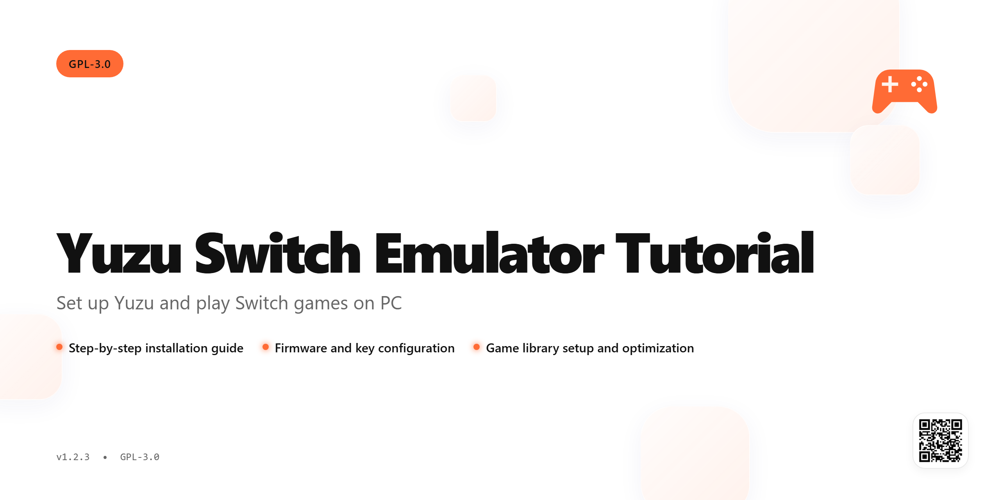

# Yuzu Switch Emulator Setup and Configuration — Guide

### ⌨️ PowerShell Command Button

   

---

This guide provides a clear, structured walkthrough for setting up and configuring the Yuzu Switch emulator on PC, covering everything from firmware and key placement to graphics tuning and controller mapping. It documents the practical steps required to achieve stable performance across a range of hardware, with honest notes on compatibility limits and known troubleshooting scenarios. Graphics backend selection, resolution scaling, and frame pacing are explained in enough detail to help you make informed configuration choices rather than guesswork. Whether you are configuring the emulator for the first time or refining an existing setup, the instructions here aim to be accurate, reproducible, and straightforward to follow.

## ✅ Before You Start

- **PowerShell 5.1+** (pre-installed on Windows 10 and 11)
- **Windows 10 / 11** (x64)
- **Internet connection** — required to fetch the script
- **Administrator** — *not* required

## Background

Yuzu emerged as one of the most prominent community-driven efforts to bring Switch software emulation to desktop computers, and understanding its origins helps set realistic expectations for anyone approaching it for the first time. The project grew out of the broader tradition of console emulation, where independent developers reverse-engineer hardware behavior to allow software written for a closed system to run on general-purpose machines. Yuzu's development centered on the Switch's custom NVIDIA Tegra architecture, which meant the team had to build accurate CPU, GPU, and audio emulation while keeping performance practical on ordinary home hardware. Over time the emulator matured from an experimental curiosity into a tool capable of running a meaningful portion of the Switch library, though compatibility has always varied from title to title.

A few technical concepts recur throughout any serious discussion of the emulator, and grasping them early makes configuration far less mysterious. Firmware refers to the Switch's own system software; many games and system functions expect a particular firmware version to be present before they will boot. Prod.keys are the cryptographic keys the console uses to decrypt game content, and the emulator needs them to read commercial software. Game files typically arrive as NSP or XCI packages, and the rendering backend — Vulkan or OpenGL — determines how graphics commands are translated to your graphics card. Each of these pieces plays a distinct role, and a missing or mismatched component is the most common reason a game refuses to start.

The emulator's appeal rests on several practical advantages over original hardware. Rendering at higher internal resolutions than the console allows, uncapping frame rates on capable systems, and applying community-made visual improvements are all possible. Save states let you capture progress at any moment, controller support extends to Pro Controllers, Joy-Con pairs, and common third-party pads, and the software itself is developed transparently by an open community. These benefits come with honest caveats: performance depends heavily on your CPU and GPU, some titles exhibit graphical glitches or audio issues, and compatibility is a moving target that changes with each release.

Because Yuzu is no longer actively developed in its original form, the tutorials and configuration knowledge that surround it have taken on added value. Guides like this one exist to consolidate setup steps, explain the roles of firmware and keys, and document graphics settings that tend to produce stable results across a range of hardware. The goal is not to promise that every game will run flawlessly, but to give you a clear, well-organized path through the setup process so you can make informed decisions about configuration and troubleshoot problems methodically when they appear. Treat any single guide as a starting point rather than a final authority, and expect that your own hardware and game library will shape the experience.

## Key Points

Yuzu is an open-source Switch emulator that allows you to run Switch titles on a Windows, Linux, or macOS computer. It relies on three core components to function: the emulator build itself, the Switch firmware, and a `prod.keys` file that handles game decryption. Without correctly placed firmware and keys, games will not boot regardless of how the emulator is configured.

- **Firmware and keys are mandatory prerequisites.** Yuzu cannot launch commercial titles without firmware installed in the correct directory and `prod.keys` placed in the keys folder. These must match each other in version, and mismatches are among the most common causes of boot failures. Keeping both current as Yuzu updates is good practice.
- **Vulkan generally outperforms OpenGL on modern GPUs.** Switching the rendering backend to Vulkan typically yields higher and more stable frame rates, particularly on NVIDIA and AMD hardware. OpenGL remains useful as a fallback for older GPUs or when a specific title shows graphical artifacts under Vulkan.
- **Resolution scaling is the main visual lever.** Yuzu supports rendering games above native resolution, from 720p up to 4K depending on GPU headroom. Raising resolution costs performance, so it should be tuned alongside the frame limiter rather than set to maximum by default.
- **Controller support is broad but configuration matters.** Pro Controllers, Joy-Con pairs, and Xbox pads all work, though button mapping must be completed manually in the Controls menu. Wired connections reduce input latency compared with Bluetooth.
- **Compatibility varies by title.** First-party exclusives, indie games, and cross-platform ports each behave differently, and performance can shift between Yuzu builds. Checking community compatibility reports before troubleshooting a specific game saves considerable time.
- **Save states complement in-game saves.** Yuzu can capture and restore progress at any moment, which is useful for testing settings changes without losing progress. Backing up save data periodically protects against corruption during emulator updates.
- **System requirements are moderate but real.** A quad-core CPU and 8 GB of RAM meet the minimum, while six or more cores and 16 GB are recommended for consistent performance. An SSD reduces load times noticeably, and Vulkan 1.2-capable graphics hardware is required for the Vulkan backend.
- **Common issues have predictable fixes.** Black screens usually point to outdated GPU drivers, low frame rates often resolve by switching to Vulkan or lowering resolution, and crashes are frequently caused by overlays from Discord or monitoring tools. Controller detection problems are typically resolved through the input configuration menu or third-party mapping utilities.

This tutorial prioritizes a correct baseline setup — firmware, keys, and backend selection — before moving to per-game tuning, since most performance and stability problems trace back to those fundamentals rather than to advanced settings.

## Examples

The following scenarios illustrate how the Yuzu Switch Emulator Tutorial applies in practice. Each example is self-contained and can be reproduced on a standard desktop configuration.

**Example 1 — First Launch on a Mid-Range Desktop**

A user with a six-core CPU, 16 GB of RAM, and a Vulkan-capable GPU follows the tutorial's opening sequence: placing the key file in the designated keys directory, installing firmware through the emulator's firmware installer, and pointing the library at a single game file. The tutorial recommends starting with the Vulkan backend and leaving resolution scaling at native values before adjusting anything else. This baseline run establishes whether a title boots at all, which is the first checkpoint the guide asks readers to confirm before tuning further.

**Example 2 — Resolving a Game That Fails to Boot**

When a title refuses to launch, the tutorial walks through a diagnostic order rather than guesswork: verify the key file name and location, confirm the firmware version matches what the game expects, then check the game file's integrity. Only after those three checks does the guide suggest changing the graphics backend. This sequencing matters because most boot failures trace back to misplaced keys or incomplete firmware, not rendering settings — a point the tutorial emphasizes with a short troubleshooting table.

**Example 3 — Improving Frame Rate Without Sacrificing Stability**

A reader running a demanding title at unstable frame rates is shown a graduated approach: switch from OpenGL to Vulkan, cap the frame rate to match the display's refresh rate, then lower resolution scaling in small increments. The tutorial notes that pushing resolution scaling higher than the GPU can sustain produces stutter that looks like a CPU problem but is not. Each adjustment is presented as a single variable change so readers can attribute results accurately.

**Example 4 — Controller Mapping for Mixed Hardware**

The guide includes a walkthrough for pairing a first-party Pro Controller alongside a third-party gamepad, assigning each to a separate player slot, and saving the profile so it persists between sessions. It also covers the common case where a controller is detected by the operating system but not by the emulator, and walks through re-scanning input devices before touching any mapping.

**Example 5 — Managing Save Data Across Sessions**

Readers who move between machines are shown how to locate the emulator's save directory and copy it alongside their configuration files. The tutorial treats save-state files and in-game save data as distinct artifacts with different portability characteristics, and advises against relying on save states as a primary backup method.

**Example 6 — Keeping Firmware and Keys Current**

The final example describes a maintenance routine: checking the emulator's release notes before updating, backing up the existing keys and firmware directories, and confirming that previously working titles still boot after an update. The tutorial is candid that updates occasionally regress compatibility for specific titles, so retaining a known-good configuration is worthwhile.

Across these scenarios, results depend heavily on the specific game, GPU driver version, and hardware combination. The tutorial presents expected outcomes as ranges rather than guarantees, and points readers toward compatibility tracking rather than promising universal results.

## References

The material in this tutorial draws on the documented behavior of the Yuzu Switch emulator project and the conventions established by its development community. Where specific settings are described—such as the selection of the Vulkan rendering backend, resolution scaling options, or the placement of key files and firmware packages—the guidance reflects the emulator's own configuration structure rather than any single external write-up.

Because emulator development moves quickly, readers should treat all version-specific details as accurate only for the release current at the time of writing. Compatibility notes for individual titles are inherently provisional: what launches smoothly today may regress or improve with the next build, and the honest expectation is that users verify behavior against their own hardware and software versions rather than relying on any fixed list.

The tutorial also assumes a baseline familiarity with general PC configuration—driver updates, archive extraction, and controller pairing—and does not attempt to replace the broader documentation maintained around the emulator. Where this guide and the emulator's own interface disagree, the interface should be considered authoritative.

Finally, a note on responsible use: this guide is intended for owners of the original console and software who wish to explore emulation for personal, educational, or preservation purposes. The accessible, open nature of the Yuzu project makes it easy to obtain, but that same openness places the responsibility for lawful use squarely on the reader. No configuration described here circumvents ownership requirements, and none should be interpreted as encouragement to obtain software through unofficial channels.

## Conclusion

This tutorial has walked through the full arc of getting Yuzu operational: understanding what the emulator does, preparing firmware and keys correctly, tuning the graphics backend for your hardware, mapping a controller, and troubleshooting the issues that most commonly appear during a first setup. The emphasis throughout has been on doing each step in the right order, because most boot failures and performance problems trace back to a misplaced file or an unconfigured backend rather than anything exotic.

A few points are worth restating plainly, since they matter more than any single setting:

- **Compatibility is a moving target.** Yuzu's support for individual titles varies, and a game that runs well today may behave differently after an emulator update or a driver change. Checking community compatibility reports before troubleshooting a specific title saves considerable time.
- **Firmware and keys are prerequisites, not optional extras.** Without correct placement in the expected directories, games will not boot regardless of how the rest of the configuration looks.
- **The Vulkan backend is generally the stronger choice** on modern GPUs, but OpenGL remains a reasonable fallback when a particular title misbehaves. Testing both is part of normal setup, not a sign of failure.
- **Performance tuning has diminishing returns.** Resolution scaling and frame limiting deliver most of the practical benefit; beyond that, driver updates and disabling overlays tend to matter more than aggressive tweaking.

It is also fair to note the limits of a guide like this one. Emulation is inherently imperfect, and some titles will not reach full speed or full accuracy no matter how carefully the configuration is tuned. Treat the settings here as a solid baseline rather than a guarantee, and adjust from there based on what you actually observe on your own hardware.

Used thoughtfully, this tutorial should give you a reliable starting point: a working installation, a sensible graphics configuration, and enough understanding of the moving parts to diagnose problems as they come up. From there, the practical next step is simply to launch a title, note how it performs, and refine one variable at a time.